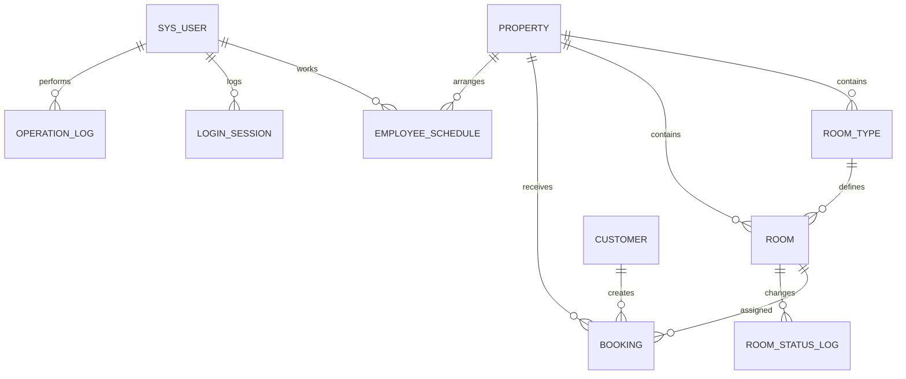

# yeu 民宿酒店预订系统的设计与实现

## 摘要

随着短途旅行、周末度假和个性化住宿需求增长，民宿与中小型酒店需要一套能够兼顾房态、预订、客户、入住退房、人员排班和运营追踪的管理系统。传统依赖表格或分散聊天记录的管理方式容易出现房态不同步、预订冲突、责任记录不清晰等问题。

本毕业设计拟设计并实现一套基于 Java 的民宿酒店预订管理系统。系统采用前后端分离架构，后端使用 Spring Boot、Spring Security、MyBatis-Plus 和 MySQL，前端使用 Vue 3、Element Plus 与 ECharts。系统设置普通员工与管理员两类角色：普通员工负责门店、房型房间、客户、预订、入住退房和排班等日常业务；管理员在此基础上拥有员工账号管理和审计能力，可以查看员工上线时间、下线时间、在线状态和具体操作记录。

系统通过 JWT 实现无状态身份认证，通过 BCrypt 保护密码，通过 AOP 统一记录关键操作日志，通过数据库状态约束和业务校验减少房间预订冲突。项目最终形成可运行的管理系统、数据库初始化脚本、接口文档和毕业设计说明，为同类中小型住宿业务的信息化管理提供参考。

**关键词：** 民宿管理；酒店预订；Spring Boot；Vue；MySQL；权限控制；操作审计

## 1. 课题背景与意义

### 1.1 课题背景

民宿和中小型酒店通常具有房量不大、业务变化灵活、员工角色交叉等特点。日常经营中需要同时关注房间是否空闲、客户何时到店、哪些订单已确认、退房后是否完成清洁、员工当天在哪个门店和班次工作等问题。若使用纸质记录、电子表格或即时通信工具分散管理，会形成多个信息孤岛。

当订单量增加时，主要问题包括：

1. 房态更新不及时，可能导致重复预订。
2. 预订、入住、退房、清洁等状态缺少统一流程。
3. 客户资料重复登记，历史信息难以复用。
4. 员工排班与门店工作安排缺少集中视图。
5. 管理员难以追踪员工在系统中的关键操作。
6. 经营数据需要人工汇总，无法快速形成运营总览。

### 1.2 研究意义

本课题的研究与实现意义主要体现在以下方面：

- 将预订、房态、客户和排班业务整合到一个统一平台中。
- 通过状态流转减少人工沟通成本和重复预订风险。
- 通过角色权限和操作审计增强系统的可管理性。
- 通过图表和统计数据帮助管理者了解入住率、预订趋势和营收情况。
- 完成一次从需求分析、数据库设计、接口开发到前端交互和测试的完整工程实践。

## 2. 需求分析

### 2.1 用户角色

系统包括普通员工和管理员两类用户。

普通员工的业务目标：

- 维护民宿和酒店基础资料。
- 管理房型、房间和实时房态。
- 处理客户登记、预订、入住、退房和取消。
- 执行房间清洁和维护调度。
- 查看并管理员工排班。

管理员的业务目标：

- 包含普通员工的全部权限。
- 新增、修改、停用和删除普通员工账号。
- 重置员工密码。
- 查看所有员工的登录会话、上线时间、下线时间和在线状态。
- 查看所有员工的业务操作日志。

### 2.2 功能需求

#### 2.2.1 身份认证

- 用户通过账号和密码登录。
- 登录成功后返回 JWT。
- 系统记录本次登录时间、IP 和用户代理。
- 用户主动退出时记录下线时间。
- 已下线会话的 JWT 不再能够访问业务接口。

#### 2.2.2 门店与房间管理

- 管理门店名称、类型、地址、联系电话和营业状态。
- 区分民宿与酒店两种类型。
- 管理房型名称、可住人数、基础价格和状态。
- 管理房间编号、楼层、备注和当前房态。

#### 2.2.3 房态调度

房间状态包括：

- `AVAILABLE`：空闲可预订。
- `RESERVED`：已预订。
- `OCCUPIED`：已入住。
- `CLEANING`：清洁中。
- `MAINTENANCE`：维护中。

每次状态调整记录调整前后状态、操作员工、时间和说明。

#### 2.2.4 预订与入住

- 创建预订时选择门店、房间、客户和入住区间。
- 系统检查房间是否在相同日期存在有效预订。
- 系统根据房型基础价格与入住晚数计算金额。
- 已确认预订可以办理入住。
- 已入住预订可以办理退房，退房后房间进入清洁状态。
- 待确认或已确认预订可以取消。

#### 2.2.5 客户管理

- 维护姓名、手机号、证件号码、邮箱和偏好备注。
- 预订时从客户档案中选择客户。
- 有历史预订的客户不允许直接删除，避免破坏业务记录。

#### 2.2.6 排班管理

- 按员工、门店、日期和班次进行安排。
- 班次包括早班、午班和夜班。
- 状态包括已排班、已完成和请假。
- 同一员工同一天同一班次不能重复排班。

#### 2.2.7 员工管理

- 管理员可以创建员工账号。
- 可以修改员工姓名、手机号、角色和账号状态。
- 可以重置密码。
- 不能停用或删除当前登录账号。
- 不能删除或降级最后一个可用管理员。

#### 2.2.8 审计管理

- 管理员查看登录会话记录。
- 管理员查看操作日志。
- 操作日志包含用户、模块、动作、请求方式、请求地址、IP、结果和时间。

#### 2.2.9 运营总览

- 展示可用房间数、入住率、今日接待和本月预订金额。
- 展示近两周预订趋势。
- 展示房间状态分布。
- 展示最近预订列表。

### 2.3 非功能需求

- **安全性：** 密码加密、JWT 校验、管理员接口权限隔离、会话失效控制。
- **可用性：** 蓝白色管理端界面，常用操作集中在列表页和弹窗中。
- **可维护性：** 后端按门店、预订、客户、排班和系统模块分层。
- **数据一致性：** 预订日期重叠校验、唯一房号、重复排班校验、删除关联保护。
- **响应式：** 支持桌面端常见分辨率，移动端使用抽屉导航和自适应表单。
- **可扩展性：** 可继续扩展支付、发票、渠道订单、消息提醒和多门店经营分析。

## 3. 系统总体设计

### 3.1 总体架构

系统采用前后端分离架构。

```text
浏览器
  │
  ▼
Vue 3 + Element Plus + ECharts
  │  HTTP / JSON / JWT
  ▼
Spring Boot Web API
  ├─ Spring Security
  ├─ AOP 操作审计
  ├─ 业务 Service
  └─ MyBatis-Plus
  │
  ▼
MySQL 8
```

前端负责页面渲染、表单交互、筛选分页和图表展示。后端负责身份认证、权限校验、业务规则、数据持久化和审计。数据库负责保存业务实体、状态和审计记录。

### 3.2 后端分层

- `controller`：接收请求、参数校验和返回统一响应。
- `service`：实现业务规则、事务和状态流转。
- `mapper`：基于 MyBatis-Plus 完成数据访问。
- `entity`：对应数据库业务实体。
- `security`：JWT、过滤器、安全工具和安全配置。
- `system`：员工、登录会话、操作日志和审计服务。
- `common`：统一响应、分页结构、业务异常和全局异常处理。

### 3.3 前端结构

- `views`：业务页面。
- `layouts`：应用主框架、侧栏和顶栏。
- `components`：页面标题、状态标签和趋势图。
- `router`：路由和角色访问控制。
- `stores`：登录状态和用户信息。
- `api`：Axios 实例和统一错误处理。
- `styles`：全局蓝白色主题和响应式样式。

## 4. 数据库设计

### 4.1 核心数据表

| 表名 | 说明 |
| --- | --- |
| `sys_user` | 员工账号、角色、状态和密码哈希 |
| `login_session` | 员工登录、下线、在线状态和 IP |
| `operation_log` | 关键业务操作审计日志 |
| `property` | 民宿或酒店门店 |
| `room_type` | 房型、人数、基础价格 |
| `room` | 房间编号、楼层和实时房态 |
| `customer` | 客户档案 |
| `booking` | 预订、入住和退房业务记录 |
| `room_status_log` | 房态变更历史 |
| `employee_schedule` | 员工排班 |

### 4.2 主要实体关系



### 4.3 关键约束

- 登录账号唯一。
- 同一门店房号唯一。
- 客户手机号唯一。
- 预订编号唯一。
- 同一员工同一天同一班次唯一。
- 房间预订必须满足 `入住日期 < 退房日期`。
- 有效预订之间不能出现相同房间的日期重叠。
- 删除门店前必须先清理房型和房间。
- 删除房型前必须先清理房间。
- 删除房间或客户前必须没有关联预订。

## 5. 核心功能实现

### 5.1 登录与会话

登录流程如下：

1. 根据账号查询员工。
2. 校验账号状态。
3. 使用 BCrypt 校验密码。
4. 创建 `login_session`，状态为 `ONLINE`。
5. 生成包含用户编号、角色和会话编号的 JWT。
6. 返回令牌和用户基础信息。

每次受保护请求经过 JWT 过滤器时，会同时检查令牌签名和会话状态。当用户退出后，会话变为 `OFFLINE`，旧令牌随即失效。

### 5.2 权限控制

后端使用 Spring Security 统一配置：

- `/api/auth/login` 和健康检查允许匿名访问。
- `/api/users/**` 与 `/api/audit/**` 只允许管理员。
- 其他 `/api/**` 接口要求登录。

前端路由也按角色隐藏管理员菜单，但真正的安全边界仍由后端保证。

### 5.3 预订冲突校验

判断两个日期区间是否重叠的条件为：

```text
已有预订.入住日期 < 新预订.退房日期
且
已有预订.退房日期 > 新预订.入住日期
```

系统只对 `PENDING`、`CONFIRMED`、`CHECKED_IN` 三种有效状态进行冲突判断，并排除正在编辑的当前预订。

### 5.4 预订状态流转

```text
CONFIRMED ──入住──> CHECKED_IN ──退房──> COMPLETED
     │
     └──取消──> CANCELLED
```

创建预订后，如果房间当前为空闲，则房间转为已预订。入住后房间转为已入住。退房后房间转为清洁中。取消预订后，如果房间仍为已预订，则恢复为空闲。

### 5.5 操作审计

系统通过 `@AuditAction` 注解和 Spring AOP 在关键控制器方法执行后记录日志。记录内容包括：

- 员工编号、账号和姓名。
- 业务模块和操作名称。
- HTTP 方法、请求地址和来源 IP。
- 执行成功或失败。
- 操作时间。

审计写入与业务操作解耦，避免在每个控制器中重复编写记录逻辑。

### 5.6 运营统计

仪表盘使用聚合查询和列表查询组合生成：

- 房间总数和空闲数。
- 入住与已预订房间计算入住率。
- 今日预抵和预离。
- 本月非取消预订金额。
- 近两周预订数量与金额。
- 房间状态分布。
- 最近预订。

## 6. 界面设计

系统采用蓝白色调。深蓝色用于品牌标识和主要按钮，浅蓝用于选中状态与辅助背景，白色用于内容面板，灰色用于文字层级，并通过绿色、橙色、红色表示业务状态。

页面采用固定侧栏与顶部状态栏布局，主要管理页面使用“筛选条件 + 数据表格 + 分页 + 编辑弹窗”的结构。移动端隐藏固定侧栏，改为抽屉式导航，表单自动切换为单列布局。

## 7. 系统测试

### 7.1 环境测试

| 项目 | 环境 |
| --- | --- |
| 操作系统 | Windows 11 |
| JDK | 17.0.19 |
| Maven | 3.8.4 |
| Node.js | 24.18.0 |
| npm | 11.16.0 |
| MySQL | 8.0.45 |

### 7.2 功能测试用例

| 编号 | 测试内容 | 预期结果 |
| --- | --- | --- |
| T01 | 管理员正确登录 | 返回 JWT，进入运营总览 |
| T02 | 错误密码登录 | 登录失败并提示账号或密码错误 |
| T03 | 普通员工访问员工列表 | 返回 HTTP 403 |
| T04 | 管理员访问员工列表 | 正常返回员工分页数据 |
| T05 | 创建日期重叠的房间预订 | 系统阻止并提示房间已被预订 |
| T06 | 已确认预订办理入住 | 预订转为已入住，房间转为已入住 |
| T07 | 已入住预订办理退房 | 预订转为已完成，房间转为清洁中 |
| T08 | 房间清洁完成后调度为空闲 | 房态更新并产生变更记录 |
| T09 | 重复安排同员工同日期同班次 | 系统阻止重复排班 |
| T10 | 删除最后一个管理员 | 系统阻止删除 |
| T11 | 查看员工上线、下线时间 | 管理员可看到登录会话记录 |
| T12 | 查看业务操作日志 | 管理员可看到操作模块、动作、结果和时间 |

### 7.3 已完成的联调验证

- 后端 56 个 Java 源文件编译成功。
- 可执行 JAR 打包成功，输出目录为 `backend/build`。
- 前端 2237 个模块完成生产构建。
- MySQL 中 10 张表及演示数据创建成功。
- 管理员登录、仪表盘、员工、门店和审计接口通过真实数据库验证。
- 普通员工访问管理员接口返回 HTTP 403。

## 8. 项目特色

1. 将预订、房态、清洁、入住退房和排班放在同一业务闭环中。
2. 管理员同时拥有业务权限和审计权限，角色差异明确。
3. 登录会话与 JWT 联合校验，退出后旧令牌立即失效。
4. 操作日志通过 AOP 统一采集，降低重复代码。
5. 前后端分离并使用 Swagger 提供接口文档，便于继续扩展。
6. 蓝白色界面兼顾毕业设计展示效果和日常管理工具的实用性。

## 9. 可扩展方向

- 增加消费者端小程序或网页进行在线选房和支付。
- 接入微信支付、支付宝或第三方渠道订单。
- 增加短信、邮件和站内消息通知。
- 增加发票、押金、退款和财务对账。
- 增加房量日历、拖拽排班和保洁任务派发。
- 增加 Redis 会话缓存、验证码和登录限流。
- 增加 Docker 部署与自动化测试流水线。
- 增加多租户与连锁门店经营分析。

## 10. 论文建议目录

1. 绪论
2. 相关技术与开发工具
3. 系统需求分析
4. 系统总体设计
5. 数据库设计
6. 系统详细设计与实现
7. 系统测试
8. 总结与展望

## 11. 总结

本系统围绕民宿与中小型酒店的实际运营流程，完成了从登录授权、门店房型管理、客户预订、入住退房、房态调度到员工排班和操作审计的完整实现。系统结构清晰，业务状态明确，能够作为毕业设计答辩演示项目，也可以在此基础上继续扩展在线预订、支付和财务功能。
